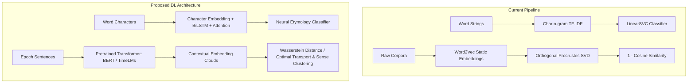

# ETYMO: Deep Learning Transformation Plan 🧠🚀

This document outlines the step-by-step roadmap to transition **ETYMO** from classical machine learning (TF-IDF, LinearSVC, static Word2Vec, Orthogonal Procrustes) to modern **Deep Learning (DL)** architectures using **PyTorch**, **Transformers**, and **Optimal Transport**.

---

## 🏗️ Architecture Comparison



---

## 📋 System Hardware Context
* **GPU Detected:** NVIDIA GeForce RTX 4050 Laptop GPU (6GB VRAM, CUDA 13.2 / PyTorch CUDA support available).
* **Environment:** Linux (x86_64) using `uv` for package management and Python 3.12.

---

## 🎯 Phase Breakdown

### Phase 1: Deep Learning Etymology Classifier (`src/dl_classifier.py`)
Replace the flat TF-IDF bag-of-ngrams and LinearSVC with a character-level sequence neural network that learns morphological roots and affix hierarchies.

1. **Model Architecture:**
   - **Input:** Padded character index sequence of the target word.
   - **Embedding Layer:** 64-dim learned character embeddings.
   - **Sequence Encoder:** Bidirectional LSTM (`hidden_dim=128`, 2 layers, dropout 0.3) OR Multi-scale 1D-CNN (kernels 2, 3, 4, 5).
   - **Self-Attention Pooling:** Aggregates character representations weighting morphologically critical stems.
   - **Classifier Head:** Linear layer projecting to the 6 origin classes (`Germanic`, `Latin`, `Greek`, `Sanskrit`, `PIE`, `Other`).
2. **Dataset & Training:**
   - Train on existing `data/origin_dataset.csv` (~5,500 words).
   - Stratified train/val/test split (80/10/10).
   - AdamW optimizer with cosine annealing learning rate scheduler.
   - Weighted Cross-Entropy Loss to handle class imbalances.
3. **Artifacts Output:**
   - Model weights: `models/etymology_bilstm.pt`
   - Character vocabulary: `models/char_vocab.json`
   - Performance evaluation report & confusion matrix: `results/dl_classifier_report.txt`
4. **Estimated Duration:** ~15–20 minutes dev, ~30 seconds training on RTX 4050.

---

### Phase 2: Contextualized Diachronic Embeddings (`src/dl_embeddings.py`)
Replace single static Word2Vec vectors with contextualized token representations extracted from sentences across epochs, resolving the **polysemy problem**.

1. **Pipeline:**
   - Extract up to $N = 100$ representative sentences per tracked word from:
     - **Corpus A (Historical 1800s):** Project Gutenberg texts.
     - **Corpus B (Modern 2000s):** Wikipedia / modern corpus.
   - Pass sentences through a pretrained Transformer (e.g., `bert-base-uncased` or historical `MacBERTh`).
   - Extract token activations from the final 4 hidden layers (mean-pooled or concatenated).
2. **Representation Output:**
   - For each tracked word $w$, generate an embedding point cloud:
     $$\mathbf{E}_{\text{old}}(w) \in \mathbb{R}^{N \times 768}, \quad \mathbf{E}_{\text{new}}(w) \in \mathbb{R}^{N \times 768}$$
3. **Storage:**
   - Save extracted embeddings in `models/embeddings/contextual_embeddings.h5` or `.npz` for fast indexed querying.
4. **Estimated Duration:** ~25 minutes dev, ~3–5 minutes GPU inference on RTX 4050.

---

### Phase 3: Optimal Transport & Semantic Drift (`src/dl_drift.py`)
Replace single-point cosine distance with geometric distribution comparison between historical and modern sense clouds.

1. **Drift Metrics:**
   - **2-Wasserstein Distance (Earth Mover's Distance):** Quantifies minimal geometric work required to transform the 19th-century meaning cloud into the modern cloud:
     $$\mathcal{W}_2(\mathbf{P}_{\text{old}}, \mathbf{P}_{\text{new}}) = \left( \inf_{\gamma \in \Pi} \int \|\mathbf{x} - \mathbf{y}\|^2 \mathrm{d}\gamma(\mathbf{x}, \mathbf{y}) \right)^{1/2}$$
   - **Centroid Shift:** Cosine distance between mean contextual representations.
   - **Sense Density Change:** Gaussian Mixture or HDBSCAN clustering to detect birth of new senses (e.g., *mouse* as hardware device) vs obsolete senses.
2. **Analysis:**
   - Aggregate Wasserstein drift scores across etymological origin classes.
   - Statistical hypothesis test (Kruskal-Wallis & Mann-Whitney U) confirming if deep semantic drift patterns mirror historical findings.
3. **Output:**
   - `results/dl_drift_scores.csv`
   - `results/dl_origin_drift_summary.csv`
4. **Estimated Duration:** ~15–20 minutes dev, ~1–2 minutes compute.

---

### Phase 4: Full-Stack Web App Integration (`web/app.py` & UI)
Integrate the Deep Learning models into the Flask dashboard while keeping backward compatibility.

1. **API Updates:**
   - Add `/api/dl/classify/<word>`: Returns softmax probability distribution and attention weights highlighting which characters/affixes influenced the prediction.
   - Add `/api/dl/word/<word>`: Returns contextualized Wasserstein drift scores and sense cluster counts.
2. **UI Enhancements:**
   - Explorer page: Toggle between **Classical ML (SVM/Word2Vec)** and **Deep Learning (BiLSTM/BERT)**.
   - Attention heatmap visualization showing how the neural network reads prefixes and suffixes.
   - 2D UMAP scatter showing the actual contextual point cloud distributions per word rather than a single point.
3. **Estimated Duration:** ~20 minutes dev.

---

## 📦 Required Dependencies to Add
```bash
uv add torch torchvision torchaudio --index-url https://download.pytorch.org/whl/cu121
uv add transformers datasets pot h5py
```

---

## 🚦 Recommended Execution Order

1. **Milestone 1:** Add PyTorch dependency & implement **Phase 1** (Char-BiLSTM Classifier).
2. **Milestone 2:** Implement **Phase 2 & 3** (Contextualized Sentence Embeddings & Wasserstein Drift).
3. **Milestone 3:** Connect new DL models to the **Flask web app** and verify via dashboard.
